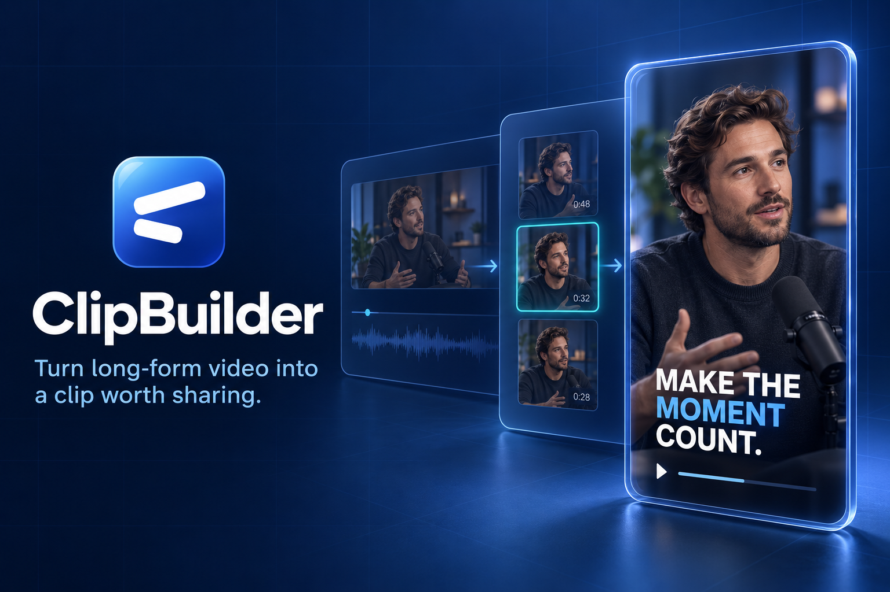

<h1 align="center">ClipBuilder</h1>

<p align="center">
  <strong>Turn long-form video into a clip worth sharing.</strong>
</p>

<p align="center">
  <a href="docs/CLIPBUILDER_DEMO_SOURCE_OF_TRUTH.md">Product architecture</a>
  ·
  <a href="docs/tickets/README.md">Implementation tickets</a>
  ·
  <a href="docs/README.md">Documentation</a>
</p>

<p align="center">
  
</p>

ClipBuilder is an automatic AI-assisted clipping demo that finds strong moments
inside long-form conversations and turns one visitor-selected moment into a
polished vertical clip with active-speaker framing, one fixed caption style,
and well-timed contextual visuals.

The product is designed around one complete result—not a pile of disconnected
AI tools or editing controls. It understands the conversation, proposes up to
four moments grounded in the transcript, lets the visitor choose exactly one,
automatically composes it, and renders a real downloadable MP4.

## Why ClipBuilder

| Find the moment | Follow the speaker | Build the visual story |
| --- | --- | --- |
| Identify up to four self-contained candidate moments and explain why each one works without padding weak results. | Detect who is actively speaking and keep that person centered as cameras and speakers change. | Balance the original footage with transcript-grounded stills, cutaways, information cards, and exact equations. |

## From upload to finished clip

1. **Add the conversation** — upload an owned or licensed recording, or open the purpose-built sample.
2. **Choose one moment** — preview up to four transcript-grounded candidates
   with exact source ranges and clear editorial reasoning, then select exactly
   one.
3. **Build automatically** — ClipBuilder reframes the active speaker, applies
   its fixed readable captions, and places a few contextual visual beats where
   they genuinely help.
4. **Review and confirm** — play the completed read-only preview and confirm the
   single render; there is no editor, chatbot, trim, caption-style, or visual
   control surface.
5. **Download the result** — receive one validated 1080 × 1920 H.264/AAC MP4.

Contextual visuals express what is actually being discussed using fixed graphic
templates grounded in the selected conversation.

## Built around the core edit

- **Grounded selection:** candidate moments and visual cues reference real transcript words and timestamps.
- **AI-directed framing:** active-speaker detection drives the vertical crop instead of asking the user to choose generic left, center, or right presets.
- **Purposeful visuals:** deterministic graphic cards support the spoken idea while preserving a healthy balance with the original footage.
- **Deterministic output:** validated edit data drives a shared fixed preview composition and private Node renderer; the model never generates executable media commands.
- **Demo-sized scope:** one temporary session, one selected clip, and one final export keep the experience focused and affordable.
- **No editing surface:** candidate selection and render confirmation are the
  only creative decisions exposed to the visitor.

## Planned architecture

The owner selected Gemini and private Cloud Run rendering. The [migration plan](docs/architecture/GEMINI_REMOTION_MIGRATION.md) is owner-approved. The local Node renderer foundation is verified; browser/cloud integration and live AI quality remain unfinished.

| Layer | Technology |
| --- | --- |
| Experience | Next.js, React, TypeScript |
| API and contracts | Node.js, Express, shared Zod schemas |
| Transcript and planning | Google Gemini (migration in progress) |
| Speaker and scene analysis | Google audiovisual association, validated and smoothed locally |
| Contextual visuals | Fixed React cards/diagrams from bounded Google plans |
| Composition and export | Fixed Remotion Node/Docker renderer on private Google Cloud Run |
| Temporary media | Private GCS for active-flow media, terminal deletion and independent expiry cleanup |
| Hosting | Lightweight control API plus isolated private Cloud Run media service; no database/queue |
| Abuse protection | Cloudflare Turnstile and bounded admission controls |

```text
Browser
  +-- Next.js source selection + read-only preview + download
  +-- browser-safe contracts + validated fixed composition preview
  +-- same-origin protected upload/analysis/render requests
       +-- private Express API -> server-only Google Gemini adapter
       +-- private temporary GCS + authenticated Node renderer; cleanup after flow
```

The model proposes bounded editorial data. Deterministic application code validates that data, resolves it against the source transcript, and owns every media operation.

The planned flow temporarily uploads the original to private GCS and sends a
bounded audiovisual proxy to Gemini. Private Cloud Run prepares and renders
media. Terminal deletion, independent expiry cleanup and separate provider
retention are explicit privacy requirements. Gemini speaking-face accuracy,
Node/cloud performance, full-bound media handling and device playback/download
remain unproved; see the [current migration plan](docs/architecture/GEMINI_REMOTION_MIGRATION.md).

## Repository status

CL-001 and CL-003 are implemented and locally verified. CL-002's colors/type
are an interim foundation. CL-004 previews the whole single-card journey at
`/start` in development-only fake mode: intake and simulated progress, three
prepared 58-second choices, one selection, read-only review and export states.
It does not read/upload files, edit recorded footage or produce a downloadable
video. Recorded media and owner approval of the revised UI remain pending.
Real intake/cloud transfer, protected analysis, automatic assembly, private Node
export/download and deployment remain owned by their dependency-ready tickets. Technical choices
marked as proposed remain subject to the documented validation gates.

## Explore the repository

| Area | Responsibility | Guide |
| --- | --- | --- |
| `apps/frontend` | Responsive source selection, read-only preview and download | [Frontend guide](apps/frontend/README.md) |
| `apps/backend` | Private Express API, configuration, and protected AI request boundaries | [Backend guide](apps/backend/README.md) |
| `packages/contracts` | Browser-safe schemas and compiled limits shared across the API boundary | [Contracts guide](packages/contracts/README.md) |
| `docs` | Product decisions, design research, and implementation tickets | [Documentation](docs/README.md) |
| `test` | Shared deterministic test isolation | [Agent instructions](AGENTS.md#deterministic-verification) |

For local setup and verification, start with the [backend guide](apps/backend/README.md#run-locally),
then the [frontend guide](apps/frontend/README.md#run-locally). Automated coding
agents follow the process and safety rules in [AGENTS.md](AGENTS.md#canonical-local-app-startup).

## Project documentation

- [ClipBuilder demo source of truth](docs/CLIPBUILDER_DEMO_SOURCE_OF_TRUTH.md)
- [Standalone implementation ticket index](docs/tickets/README.md)
- [Documentation map](docs/README.md)
- [Product research summary](docs/research/AI_CLIPPING_DEMO_BRIEF.md)
- [Portfolio demo build playbook](docs/reference/PORTFOLIO_DEMO_BUILD_PLAYBOOK.md)
- [Source-of-truth maintenance prompt](docs/prompts/AI_CLIPPING_SOURCE_OF_TRUTH_PROMPT.txt)

ClipBuilder is a focused portfolio demonstration, not a production video-editing service. Source recordings must be owned or licensed, temporary media must remain private and short-lived, and real user media, transcripts, credentials, generated assets, and rendered outputs must never enter version control.

<p align="center">
  Built and maintained by <a href="https://github.com/minatamer">Mina Tamer</a>.
</p>
